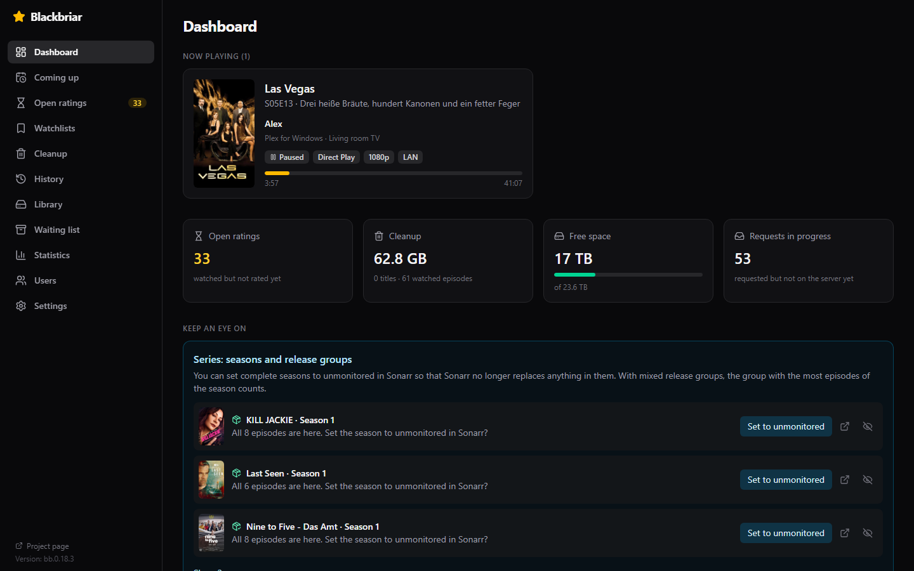
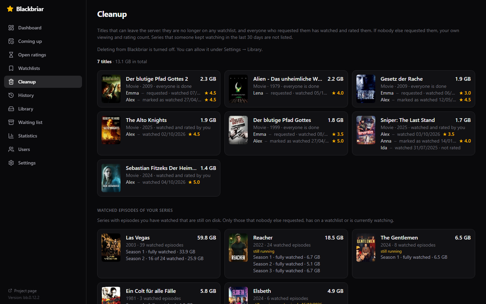
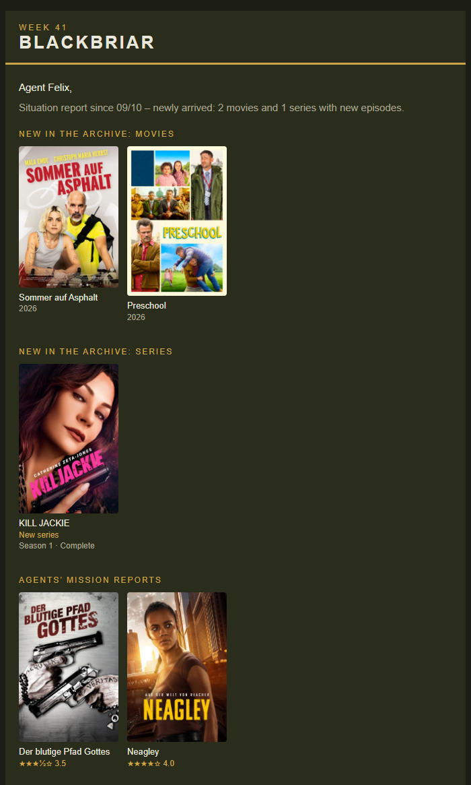
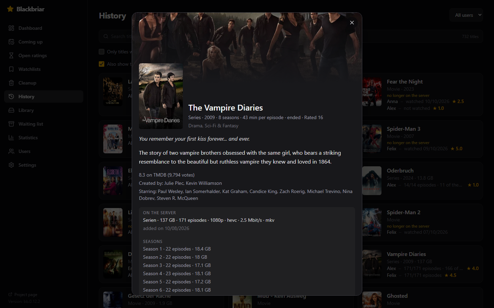

# Blackbriar

[](LICENSE)  [](https://github.com/DerAachener/blackbriar/pkgs/container/blackbriar)

**Die Begleit-App für alle, die ihren Plex-Server mit Freunden und Familie teilen.**

Blackbriar zeigt, wer auf deinem Plex-Server was schaut, und sagt dir, was weg kann. Deine Benutzer bekommen eine Mail, wenn etwas Neues da ist.

[English version](README.md) · [Änderungsverlauf](CHANGELOG.de.md)



## Was Blackbriar anders macht

**Ansehen und Merklisten zählen zuerst.** Ein Titel steht erst auf der Liste „Kann weg“, wenn ihn gerade niemand schaut, er auf keiner Merkliste mehr steht und alle, die ihn sich über Seerr gewünscht haben, ihn gesehen haben. Regeln musst du dafür nicht bauen.

**Bewertungen sind das Tüpfelchen auf dem i.** Plex speichert Bewertungen je Konto, und Tautulli zeigt nur die des Besitzers. Blackbriar liest sie für alle, damit du siehst, ob ein Titel gefallen hat, bevor du ihn löschst. Standardmäßig wartet ein Titel zusätzlich auf die Bewertung derer, die bewerten. Schaltest du die Bewertungen bei einem Benutzer ab, zählt für ihn schon das Ansehen.

**Automatische Erinnerungen:** Wer etwas gesehen, aber nicht bewertet hat oder es noch auf der Merkliste hat, bekommt eine Mail. Darin steht auch, wie man einen Titel behält.

Gedacht ist Blackbriar für Server mit ein paar Benutzern und knappem Speicherplatz. Wer nur für sich selbst sammelt, braucht es vermutlich nicht.

## Was es kann

### Beobachten
- Laufende Wiedergaben mit Fortschritt, Gerät und dem Hinweis, ob Plex direkt abspielt oder umrechnet
- Verlauf aller Konten, pro Titel: wer ihn gesehen und wie bewertet hat. Gelöschte Titel bleiben im Verlauf stehen
- Was jemand in Plex als gesehen markiert hat, zählt mit und ist als „als gesehen markiert“ ausgewiesen
- Statistik nach Benutzer, Wochentag, Uhrzeit, Gerät und Wiedergabeart

### Bewertungen (das Extra)
- Liest die Bewertungen aller Benutzer des Servers, nicht nur die des Besitzers
- Zeigt, was jemand zu Ende gesehen, aber noch nicht bewertet hat
- Schickt eine Telegram-Nachricht, sobald jemand etwas bewertet
- Wer grundsätzlich nicht bewertet, lässt sich so kennzeichnen; bei ihm zählt Ansehen als fertig

### Aufräumen
- **Kann weg:** Titel, die auf keiner Merkliste mehr stehen und die alle gesehen haben, die sie angefragt hatten (und bewertet, sofern die Bewertung bei dem Benutzer nicht abgeschaltet ist)
- Eine zweite Gruppe für Titel, die alle zu Ende gesehen, aber nicht alle bewertet haben, nach einer Wartezeit, die du festlegst
- Löschen direkt aus Blackbriar, abgestimmt mit Radarr, Sonarr und Seerr, für ganze Titel oder für gesehene Folgen. Das Löschen ist aus, bis du es in den Einstellungen erlaubst
- Bibliothek mit Größe, Codec, Auflösung und Bitrate, gefiltert nach Plex-Mediathek
- Freier Speicherplatz mit einer Schätzung, wie lange er reicht
- Hinweise zu Serien: Staffel komplett, aber in Sonarr noch beobachtet, oder Folgen einer Staffel von verschiedenen Release-Gruppen
- Ein Hinweis, wenn Plex einen Titel falsch zugeordnet hat und Seerr ihn deshalb immer wieder anfragt



### Benutzer informieren
- **Sofort-Mail,** wenn ein Titel von der eigenen Merkliste angekommen ist
- **Newsletter** mit neuen Filmen, Staffeln und Folgen sowie den neuesten Bewertungen (anonymisiert ohne Namen)
- **Erinnerung** an Titel, die jemand gesehen, aber nicht bewertet oder noch auf der Merkliste hat
- Jeder sieht nur Titel aus den Mediatheken, die für ihn freigegeben sind
- Jede Mail führt zu einer Seite mit Inhalt, Besetzung und Trailer und trägt einen Link zum Abbestellen
- Alles lässt sich als Standard für alle oder pro Benutzer einstellen



### Was kommt
- Neustarts im Kino und bei deinen Streaminganbietern für dein Land, aus TMDB
- „Meine Themen“: eigene Interessen aus TMDB-Schlagwörtern, etwa Dokus zu einem Thema
- Titel ausblenden, die dich nicht interessieren
- Einen Titel mit einem Klick in Seerr wünschen oder direkt in Radarr bzw. Sonarr öffnen

### Für den Besitzer
- Dashboard: was gerade läuft, was offen ist, wie viel Platz frei ist
- Ein Info-Fenster zu jedem Titel, aus jeder Ansicht
- Protokoll, was Blackbriar wann getan hat
- Tägliche Sicherung der eigenen Datenbank, die letzten sieben bleiben erhalten
- Anmeldung über Plex; Zugang hat nur der Besitzer des Servers
- Deutsch und Englisch



Die Bildschirmfotos zeigen die englische Oberfläche. Die Benutzernamen darin sind erfunden.

## Was du brauchst

| Dienst | Nötig | Wofür |
|---|---|---|
| Plex Media Server | ja | Wiedergaben, Verlauf, Bewertungen, Bibliothek |
| Seerr | empfohlen | Merklisten, Anfragen, „Kann weg“ |
| Radarr und Sonarr | optional | Aufräumen, Speicherplatz, Hinweise zu Serien. Je eine zweite Instanz für 4K wird unterstützt |
| TMDB-Schlüssel (kostenlos) | optional | Neustarts, Infoseiten, vollständige Staffeln |
| Telegram-Bot | optional | Nachrichten an den Besitzer |
| SMTP-Postfach | optional | Mails an deine Benutzer |
| Tautulli oder Tracearr | optional | Einmaliger Import früherer Wiedergaben |

Plex Pass brauchst du nur für den Webhook, mit dem Nachrichten sofort kommen. Ohne ihn fragt Blackbriar alle fünf Minuten nach.

Blackbriar arbeitet nur mit Plex. Jellyfin und Emby werden nicht unterstützt.

## Installation

Blackbriar läuft als einzelner Docker-Container und legt seine Daten in einem Ordner ab.

```yaml
services:
  blackbriar:
    image: ghcr.io/deraachener/blackbriar:latest
    container_name: blackbriar
    restart: unless-stopped
    # Optional: nicht als Root laufen. Der Datenordner muss dann diesem Benutzer gehören.
    # user: "1000:1000"
    ports:
      - "8787:8787"
    environment:
      TZ: Europe/Berlin
    volumes:
      - ./data:/data
```

```bash
docker compose up -d
```

Ohne Compose dasselbe als ein Befehl:

```bash
docker run -d --name blackbriar --restart unless-stopped -p 8787:8787 -e TZ=Europe/Berlin -v "$(pwd)/data:/data" ghcr.io/deraachener/blackbriar:latest
```

Auf TrueNAS fügst du das YAML oben unter Apps → Discover → Install via YAML ein und legst den Datenordner auf ein eigenes Dataset. Der Ordner muss schon da sein, TrueNAS legt ihn nicht selbst an. Mit `user: "568:568"`, dem Benutzer `apps` von TrueNAS, legst du ihn so an:

```bash
sudo mkdir -p /mnt/<pool>/blackbriar
```

```bash
sudo chown -R 568:568 /mnt/<pool>/blackbriar
```

Das gilt überall: Wer `user:` setzt, muss dem Benutzer den Datenordner geben, sonst kann Blackbriar seine Datenbank nicht schreiben und startet nicht.

Ist Port 8787 bei dir belegt, ändere die linke Zahl bei `ports`, zum Beispiel `"8790:8787"`.

`:latest` ist die neueste freigegebene Fassung. Wer bei einer festen Fassung bleiben will, nimmt ein Tag wie `:1.7.4`, oder `:1.7` für die neueste Korrektur dieser Reihe. Alle Fassungen stehen unter [Releases](../../releases). Die Images gibt es für amd64 und arm64.

1. Öffne `http://<dein-server>:8787`. Beim ersten Mal fragt Blackbriar nach einem Einrichtungscode. Er steht im Protokoll des Containers (`docker logs blackbriar`, auf TrueNAS bei der App unter „Logs“). Dann meldest du dich mit dem Plex-Konto an, dem der Server gehört, oder legst ein eigenes Konto mit Benutzername und Passwort an. Plex verbindest du dann unter Einstellungen → Plex mit einem Klick. Ab jetzt kommen nur dieses Plex-Konto und dein Passwort hinein.
2. Wähle unter Einstellungen → Plex deinen Server aus der Liste.
3. Geh die übrigen Reiter der Einstellungen durch und trag ein, was du nutzt. Jede Verbindung hat einen Test-Knopf.
4. Optional, mit Plex Pass: Kopiere die Webhook-Adresse aus Einstellungen → Plex nach Plex unter Einstellungen → Webhooks.
5. Optional: Kopiere die Adresse aus Einstellungen → Radarr bzw. Sonarr nach Radarr und Sonarr unter Settings → Connect → Webhook. Dann merkt Blackbriar ein neues oder ausgetauschtes Release nach Sekunden statt nach bis zu einer Stunde.

Der erste Abgleich liest den gesamten Verlauf und alle Bewertungen. Auf einem großen Server dauert das ein paar Minuten. Was dabei schon vorhanden ist, löst keine Nachrichten und keine Erinnerungen aus.

### Aktualisieren

```bash
docker compose pull
```

```bash
docker compose up -d
```

Auf TrueNAS holt ein Neustart der App das neue Image nur, wenn im YAML `pull_policy: always` steht. Setz die Zeile unter `image:`, wenn du `:latest` nutzt.

Was sich geändert hat, steht im [Änderungsverlauf](CHANGELOG.de.md). Die laufende Version steht unten in der Seitenleiste.

### Zugriff von außen

Die Mails an deine Benutzer enthalten Links zu den Infoseiten und zum Abbestellen. Damit sie funktionieren, muss Blackbriar unter einer öffentlichen Adresse erreichbar sein (Reverse Proxy oder Tunnel, mit https), eingetragen im Feld „Von außen“ unter Einstellungen → E-Mail oder als Umgebungsvariable `PUBLIC_URL`. Ohne sie werden die Mails trotzdem verschickt, nur ohne diese Links.

### Umgebungsvariablen

Alle Verbindungen lassen sich in den Einstellungen eintragen. Alternativ kannst du sie über Umgebungsvariablen vorgeben; was in den Einstellungen gespeichert ist, hat Vorrang. Siehe [.env.example](.env.example).

| Variable | Bedeutung |
|---|---|
| `PLEX_URL`, `PLEX_TOKEN` | Adresse des Plex-Servers, z. B. `http://192.168.1.10:32400`, und Token des Besitzers |
| `SEERR_URL`, `SEERR_API_KEY` | Seerr, z. B. `http://192.168.1.10:5055` |
| `RADARR_URL`, `RADARR_API_KEY`, `SONARR_URL`, `SONARR_API_KEY` | Radarr und Sonarr |
| `RADARR_4K_URL`, `RADARR_4K_API_KEY`, `SONARR_4K_URL`, `SONARR_4K_API_KEY` | Zweite Instanzen für 4K |
| `TMDB_API_KEY` | Schlüssel von themoviedb.org |
| `TELEGRAM_BOT_TOKEN`, `TELEGRAM_CHAT_ID` | Telegram-Bot und der Chat, an den die Nachrichten gehen |
| `MAIL_HOST`, `MAIL_PORT`, `MAIL_USER`, `MAIL_PASSWORD` | Postfach für den Versand; Port 465 oder 587 |
| `MAIL_FROM`, `MAIL_FROM_NAME` | Absenderadresse und Name |
| `PUBLIC_URL` | Adresse, unter der Blackbriar von außen erreichbar ist |
| `TAUTULLI_URL`, `TAUTULLI_API_KEY`, `TRACEARR_URL`, `TRACEARR_API_KEY` | Nur für den einmaligen Import |
| `SYNC_INTERVAL_SECONDS` | Sekunden zwischen zwei Abgleichen (Standard 300) |
| `AUTH` | `off` lässt Blackbriar ohne Anmeldung laufen. Nur hinter einem eigenen Zugangsschutz oder als Ausweg, wenn du dich ausgesperrt hast |
| `AUTH_RESET` | `1` löscht beim Start das Konto mit Passwort und alle Anmeldungen, etwa bei vergessenem Passwort. Die Daten bleiben. Danach wieder entfernen |
| `TZ` | Zeitzone, maßgeblich für die Versandzeiten der Mails |

## Wenn etwas nicht geht

- **Der Container startet immer wieder neu.** Sieh ins Protokoll. Steht dort, dass Blackbriar nicht in seinen Datenordner schreiben kann, gehört der Ordner nicht dem Benutzer aus `user:`. Die Meldung nennt den passenden `chown`-Befehl.
- **Der Einrichtungscode wird nicht angenommen.** Er steht im Protokoll des Containers und gilt, bis die erste Anmeldung geklappt hat. Nach zehn falschen Versuchen ist die Eingabe zehn Minuten gesperrt; ein Neustart hebt die Sperre auf.
- **Nach der Anmeldung wird kein Server gefunden.** Dann war es vermutlich ein Plex-Konto, dem der Server nicht gehört. Halte den Container an, leere den Datenordner und starte neu. Blackbriar beginnt von vorn, mit einem neuen Einrichtungscode.
- **Passwort vergessen:** Starte den Container einmal mit `AUTH_RESET=1`. Ist Plex verbunden, meldest du dich danach über Plex an und legst unter Einstellungen → Allgemein ein neues Passwort an. Sonst steht ein neuer Einrichtungscode im Protokoll.
- **Du kommst nicht mehr hinein,** etwa weil plex.tv nicht erreichbar ist. Setz vorübergehend die Umgebungsvariable `AUTH=off`, dann läuft Blackbriar ohne Anmeldung. Danach wieder entfernen.
- **Nach dem Neustart läuft noch die alte Fassung.** Das Image wurde nicht neu geladen, siehe „Aktualisieren“.
- **Plex lehnt das Löschen ab.** In Plex fehlt „Löschen von Medien erlauben“, siehe „Wie es funktioniert“.

## Umstieg von Tautulli oder Tracearr

Plex selbst führt nur einen einfachen Verlauf ohne Dauer, Gerät und Wiedergabeart. Wenn du Tautulli oder Tracearr genutzt hast, hol deren Wiedergaben einmalig unter Einstellungen → Import. Hast du beide, nimm die Quelle, die am weitesten zurückreicht. Danach schreibt Blackbriar jede Wiedergabe selbst mit, und das andere Werkzeug wird dafür nicht mehr gebraucht.

## Wie es funktioniert

- **Bewertungen:** Plex speichert Bewertungen pro Konto. Blackbriar holt sich bei plex.tv für jeden freigegebenen Benutzer dessen Token für deinen Server und liest damit dessen Bewertungen. Die Tokens bleiben im Arbeitsspeicher und werden nie gespeichert.
- **Gesehen:** Ein Film gilt als gesehen, sobald er im Verlauf steht oder als gesehen markiert ist, eine Serie erst, wenn alle vorhandenen Folgen gesehen wurden.
- **Merklisten:** Sie kommen über Seerr, weil nur dort die plex.tv-Anmeldungen deiner Benutzer liegen. Gelesen werden sie alle 15 Minuten.
- **Kann weg:** Ein Titel erscheint, wenn er auf keiner Merkliste mehr steht und alle, die ihn in Seerr angefragt haben, ihn gesehen und bewertet haben. Hat ihn sonst niemand angefragt, zählen Sichtung und Bewertung des Besitzers. Ohne Seerr kennt Blackbriar weder Wünsche noch Merklisten. Dann erscheint ein Titel erst, wenn du und alle anderen, die ihn angefangen haben, fertig sind, und die Liste ist nur ein Anhaltspunkt: Ob jemand den Titel noch sehen will, weiß Blackbriar nicht.
- **Löschen:** Blackbriar trägt den Titel erst aus Radarr bzw. Sonarr aus oder stellt einzelne Folgen auf „nicht beobachtet“, lässt dann Plex die Dateien löschen und setzt den Titel in Seerr zurück. Jedes Löschen wird einzeln bestätigt und protokolliert. Damit Plex löschen darf, muss dort unter Einstellungen → Bibliothek „Löschen von Medien erlauben“ eingeschaltet sein.
- **Mails:** Verschickt wird über dein eigenes Postfach, nur verschlüsselt. Bilder hängen an der Mail selbst. Führt ein Mailprogramm sie als Anhänge auf, kann Blackbriar sie stattdessen selbst ausliefern; dafür ist die öffentliche Adresse nötig.
- **Takt:** Wiedergaben alle paar Sekunden; Verlauf und Bewertungen alle fünf Minuten oder sofort über den Webhook; Merklisten alle 15 Minuten; Bibliothek stündlich; Radarr und Sonarr stündlich oder sofort über ihren Webhook.

## Datenschutz und Sicherheit

Blackbriar läuft vollständig auf deiner eigenen Hardware und schickt nichts an den Autor. Es spricht nur mit den Diensten, die du verbindest, mit plex.tv und mit TMDB. Die Mailadressen kommen aus den Plex-Konten deiner Benutzer und werden nur für die Mails verwendet, die du einschaltest.

Blackbriar hält deinen Plex-Token und die API-Schlüssel der verbundenen Dienste, und es kann Dateien löschen, wenn du es erlaubst. Behandle es wie Radarr oder Sonarr: nicht ohne https ins Internet stellen und die Anmeldung eingeschaltet lassen.

## Stand

Blackbriar ist ein Hobbyprojekt. Ich habe es gebaut, weil mir in den vorhandenen Werkzeugen Funktionen fehlten, die ich für meinen eigenen Server brauchte. Was die App können soll und nach welchen Regeln sie arbeitet, habe ich mir über Wochen überlegt und im täglichen Betrieb erprobt.

Ich bin kein Entwickler. Den Code hat ein KI-Assistent (Claude) nach meinen Vorgaben geschrieben, ich habe jede Änderung auf meinem Server getestet. Es gibt keine Gewähr. Bedenke das, bevor du das Löschen erlaubst, und sichere, was du nicht ersetzen kannst.

Blackbriar ist für einen einzelnen Server entstanden; bei anders aufgebauten Servern ist mit Ecken und Kanten zu rechnen. Getestet ist Seerr. Overseerr und Jellyseerr nutzen dieselbe Schnittstelle, sind aber nicht getestet.

Fehlermeldungen und Vorschläge sind als [Issues](../../issues) willkommen.

## Entwicklung

Benötigt Node.js 24.

```bash
npm install
```

```bash
npm run dev:server
```

```bash
npm run dev:web
```

Das Backend läuft auf Port 8787, die Oberfläche mit Live-Reload auf Port 5173. Vorher `.env.example` nach `.env` kopieren.

## Lizenz

[GPL-3.0](LICENSE)
